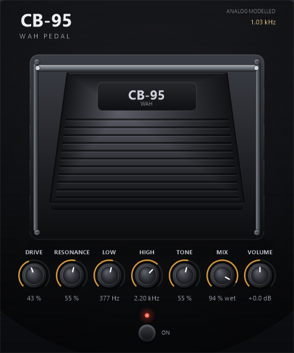
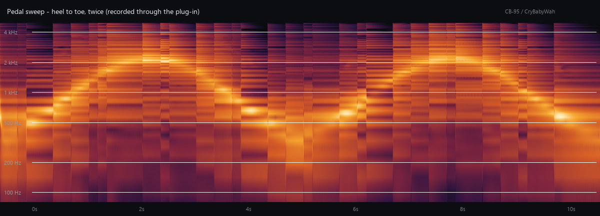

# CB-95 Wah — VST3-эмуляция педали Cry Baby

Виртуальная «квакушка» в формате **VST3 (64-bit Windows)**: резонансный тракт по мотивам
классической педали Dunlop Cry Baby GCB-95, с качающейся педалью, драйвом входного
транзисторного каскада и честным true-bypass.



Готовый плагин лежит в `dist/CryBabyWah.vst3` — это и есть установочный бандл,
собранный из исходников в этом репозитории.

---

## Быстрый старт

1. Скопируйте папку `dist/CryBabyWah.vst3` целиком в
   `C:\Program Files\Common Files\VST3` (нужны права администратора).
   Либо запустите PowerShell от администратора:

   ```powershell
   .\install.ps1
   ```

   Без прав администратора: `.\install.ps1 -User` — установит в
   `%LOCALAPPDATA%\Programs\Common\VST3`; эту папку нужно добавить
   в список VST3-папок в DAW.

2. Перезапустите DAW или запустите пересканирование плагинов.
3. В списке эффектов появится **CB-95 Wah** (категория *Filter*).

Проверено в минимальном хостере `build/wah_host.exe` (загрузка модуля, создание
компонента, обработка звука, сохранение состояния, открытие редактора). В Cubase,
Nuendo, Reaper, Studio One, FL Studio и Ableton Live 10+ плагин должен появиться
как обычный VST3-эффект — формат и точка входа стандартные.

---

## Управление

| Элемент | Действие |
|---|---|
| Корпус педали | Тянуть мышью вверх/вниз — положение педали (высота резонанса) |
| **DRIVE** | Усиление/сатурация входного каскада: от чистого звука до подгруженного |
| **RESONANCE** | Добротность контура (Q): от широкого «уа» до узкого «квака» |
| **LOW** | Нижняя граница диапазона качания: 120 … 960 Гц |
| **HIGH** | Верхняя граница диапазона: 700 Гц … 3.96 кГц (всегда выше LOW) |
| **TONE** | Выходной фильтр низких частот: 2.6 кГц (темно) … 12 кГц (ярко) |
| **MIX** | Баланс dry/wet: 0 % — чистый сигнал, 100 % — только обработанный |
| **VOLUME** | Выходной уровень, −9 … +9 дБ |
| Кнопка **ON / BYPASS** | Включение/обход; светодиод горит при включённом эффекте |
| Колесо мыши над ручкой | Изменение параметра шагами (Shift — точнее) |
| Двойной клик по ручке | Сброс параметра к значению по умолчанию |
| Shift + перетаскивание | Точная подстройка |
| Угол окна плагина | Растягивание интерфейса: 0.7×…3× с сохранением пропорций |

Интерфейс масштабируется под DPI монитора: на 4K-экране с масштабом 150 % плагин
открывается в 750×900 px с такими же крупными подписями, а не «мелкими точками».
Окно можно тянуть за угол — содержимое перерисовывается в новом размере
(пропорции 500×600 сохраняются, масштаб ограничен 0.7×…3×).

Частота среза показана в правом верхнем углу (380 Гц … 2.2 кГц) и меняется
вместе с педалью — удобно понимать, где именно находится «резонанс».

### Параметры автоматизации

| # | Название | Диапазон | По умолчанию | Примечание |
|---|---|---|---|---|
| 0 | Wah | 0…1 | 0.45 | Положение педали; отображается в Гц/кГц |
| 1 | Drive | 0…1 | 0.32 | |
| 2 | Resonance | 0…1 | 0.55 | |
| 3 | Low Freq | 0…1 | 0.55 | 120 Гц … 960 Гц (экспоненциально) |
| 4 | High Freq | 0…1 | 0.66 | 700 Гц … 3.96 кГц, не ниже Low × 1.5 |
| 5 | Tone | 0…1 | 0.55 | |
| 6 | Mix | 0…1 | 1.00 | 1.0 = только wet, 0 = чистый сигнал |
| 7 | Volume | 0…1 | 0.50 | 0.5 = 0 дБ, отображение в дБ |
| 8 | Bypass | 0/1 | 0 | Помечен флагом `kIsBypass` |

Все параметры — обычные VST3-параметры: автоматизируются, сохраняются в проекте,
поддерживают undo/redo через `beginEdit/performEdit/endEdit`.

---

## Как устроена модель

Сигнальный тракт повторяет логику дискретной схемы:

```
вход → ФВЧ 95 Гц → транзисторный каскад (асимметричный tanh, ADAA)
     → резонансный полосовой контур (TPT SVF; диапазон LOW…HIGH, по умолчанию 377–2200 Гц; Q 1.6–9)
     → компрессия пика → Tone (ФНЧ 2.6–12 кГц) → ФВЧ 45 Гц
     → dry/wet (MIX) → громкость → мягкий лимитер → выход
```

* **Резонансный контур** — zero-delay-feedback state variable filter (TPT),
  устойчивый при быстром качании педали. Границы диапазона задают ручки
  **LOW** (120…960 Гц) и **HIGH** (700 Гц…3.96 кГц); частота внутри диапазона
  `f = LOW · (HIGH/LOW)^(p^0.82)`, добротность `Q = (1.6 + 7.5·res)·(0.92 + 0.28·p)` —
  как у реальной педали, на «носке» резонанс чуть острее. HIGH всегда держится
  минимум в 1.5 раза выше LOW, чтобы полоса не «схлопывалась».
* **Транзисторный каскад** — мягкое асимметричное ограничение с антиалиасингом
  по первой производной (ADAA), поэтому гармоники не «заворачиваются» в звук.
  Смещение рабочей точки зависит от положения педали: характер гармоник
  меняется по ходу качания — это и даёт «говорящий» оттенок.
* **Сглаживание** всех параметров 18–25 мс: щелчков и зиппера при автоматизации нет.
* **Dry/wet (MIX)** — параллельный тракт: чистый сигнал смешивается с обработанным
  после Tone, поэтому ручка работает и как «глубина» эффекта, и как блендер.
* **True bypass**: в обходе буфер хоста не трогается вообще (проверено побитово).
* **Моно/стерео**: до 2 каналов, у каждого канала собственное состояние фильтров.
* **Задержка**: 0 сэмплов.



На спектрограмме видно, как резонансный «горб» уезжает с ~1 кГц на ~2.5 кГц
и обратно — это запись реального вывода плагина (`docs/demo_wah_sweep.wav`).

### Демо-звук

* `docs/demo_wah_sweep.wav` — гитарный рифф через плагин, два полных качания педали.
* `docs/demo_positions.wav` — один и тот же рифф: dry → heel → середина → toe.

---

## Сборка из исходников

Нужен только **Visual Studio C++ Build Tools** (MSVC x64) — CMake не требуется.

```bat
build.bat          :: плагин + тестовый хост + инструменты + бандл dist\CryBabyWah.vst3
build.bat clean    :: очистить build\ и dist\
```

Скрипт сам находит `vcvars64.bat` через `vswhere` (или по стандартным путям VS 2019/2022).

Что собирается:

| Файл | Назначение |
|---|---|
| `build/CryBabyWah.dll` | сам плагин (до упаковки в бандл) |
| `dist/CryBabyWah.vst3` | готовый VST3-бандл |
| `build/wah_host.exe` | минимальный VST3-хостер для проверки |
| `build/wah_render.exe` | офлайн-рендер и измерение АЧХ |
| `build/ui_preview.exe` | рендер интерфейса в PNG без DAW |

### Структура проекта

```
CryBabyWah/
├─ build.bat                  сборка одной командой
├─ install.ps1                установка бандла
├─ src/
│  ├─ dsp/WahCore.h           вся DSP-модель (header-only, без зависимостей)
│  ├─ plugin/                 VST3: компонент/процессор/контроллер, фабрика, редактор
│  └─ ui/PedalUI.*            отрисовка педали на GDI+ (не зависит от VST3)
├─ tools/                     хостер, офлайн-рендер, превью UI, анализ/спектрограммы
├─ third_party/vst3sdk/       официальные заголовки VST3 SDK (pluginterfaces)
├─ docs/                      скриншоты, демо-аудио
└─ dist/                      готовый бандл
```

DSP вынесен в `src/dsp/WahCore.h` и не зависит ни от VST3, ни от Windows — его можно
переиспользовать в VST2/AAX/CLAP или в офлайн-обработке.

---

## Проверка

```bat
build\wah_host.exe dist\CryBabyWah.vst3\Contents\x86_64-win\CryBabyWah.vst3 out.wav ui.png
```

Хостер делает всё, что делает DAW: `InitDll` → `GetPluginFactory` → `createInstance` →
`initialize` → `setupProcessing` → `process`, плюс проверяет параметры, состояние,
редактор и пограничные случаи. Типичный вывод:

```
factory
  vendor            : CryBabyWah Project
  classes           : 1
  class             : CB-95 Wah (Audio Module Class)
  class id          : 2E1B6C9A3D4F8A4C9E712B55183D77A1
interfaces        : component ok, processor ok, controller ok, single component yes
parameters
  [0] Wah          default 0.45  -> 941 Hz     flags 0x1
  [1] Drive        default 0.32  -> 32 %       flags 0x1
  [2] Resonance    default 0.55  -> 55 %       flags 0x1
  [3] Low Freq     default 0.55  -> 377 Hz     flags 0x1
  [4] High Freq    default 0.66  -> 2.20 kHz   flags 0x1
  [5] Tone         default 0.55  -> 55 %       flags 0x1
  [6] Mix          default 1.00  -> 100 % wet  flags 0x1
  [7] Volume       default 0.50  -> +0.0 dB    flags 0x1
  [8] Bypass       default 0.00  -> On         flags 0x10001
processing        : 504000 samples, in -16.5 dBFS, out -18.0 dBFS, peak -5.3 dBFS
state             : save 0x0 (40 bytes), load 0x0, pedal 0.00 -> 0.00 ok
editor            : 500 x 600, HWND supported yes
ui drag           : pedal 0.000 -> 0.504, host edits begin 2 / perform 65 / end 2
ui wheel          : mix 1.000 -> 0.940 ok
64-bit samples    : not supported (falls back to 32)
bypass            : output == input (true bypass)
mono / 96 kHz     : arrangement accepted (mono), process finite
second instance   : created and released
resize            : canResize yes, 880x1160 -> 880x1056 (0x0), onSize 0x0
view lifetime     : component released before editor survived
RESULT            : OK
```

АЧХ модели измеряется импульсным откликом:

```bat
build\wah_render.exe ir 0.0 0.3 0.55 0.55 ir_heel.wav
build\wah_render.exe ir 1.0 0.3 0.55 0.55 ir_toe.wav
python tools\analyse_ir.py build\ir_heel.wav build\ir_toe.wav
```

---

## История версий

* **1.3.0** — добавлены регуляторы **LOW** и **HIGH**: границы диапазона качания
  (120…960 Гц и 700 Гц…3.96 кГц), частота педали интерполируется между ними;
  окно стало 500×600, параметров теперь 9.
* **1.2.0** — окно плагина стало растягиваемым: canResize включён, размер ограничивается
  пропорциями 440×580 и масштабом 0.7×…3×, содержимое перерисовывается под новый размер.
* **1.1.2** — увеличены шрифты и подписи (заголовок 31 px, названия ручек 9.8 px,
  значения 10.6 px); окно стало 440×580, чтобы подписи не теснились; светодиод и кнопка
  сдвинуты ниже и больше не перекрывают значение ручки TONE.
* **1.1.1** — исправлен рендер текста в хостах, где GDI+ ещё не был инициализирован:
  шрифты создавались в списке инициализации конструктора до вызова `GdiplusStartup`,
  из-за чего `DrawString` молча ничего не рисовал (фигуры при этом были видны).
  Теперь `GdiplusStartup` вызывается до создания первого GDI+-объекта, а инструменты
  `ui_preview`/`wah_host` запускают GDI+ в том же порядке, что и плагин.
* **1.1.0** — управление колесом мыши, параметр **Mix** (dry/wet), масштабирование под
  DPI монитора, контрастные подписи и подбор шрифта с фолбэком.
* **1.0.0** — первая версия.

---

## Ограничения

* Только Windows x64 и только VST3 (VST2/AAX/CLAP не собираются).
* Обработка в 32-битном float; 64-битные буферы не поддерживаются — хост
  сконвертирует сам (это разрешено спецификацией VST3).
* Интерфейс тянется за угол окна, но пропорции 500×600 фиксированы (масштаб 0.7×…3×).
* Нет MIDI-управления педалью (CC) — при необходимости добавляется через
  `IMidiMapping`.
* Название «Cry Baby» — торговая марка Dunlop; проект независимый, название
  использовано только для описания модели-прототипа. Плагин называется **CB-95 Wah**.

---

## Лицензия

Код проекта распространяется по **GPLv3**.

Заголовки VST3 SDK (`third_party/vst3sdk/pluginterfaces`) — © Steinberg Media
Technologies, распространяются по двойной лицензии (GPLv3 / проприетарная
Steinberg VST3 License). При сборке и распространении бинарников соблюдайте
условия соответствующей лицензии.
